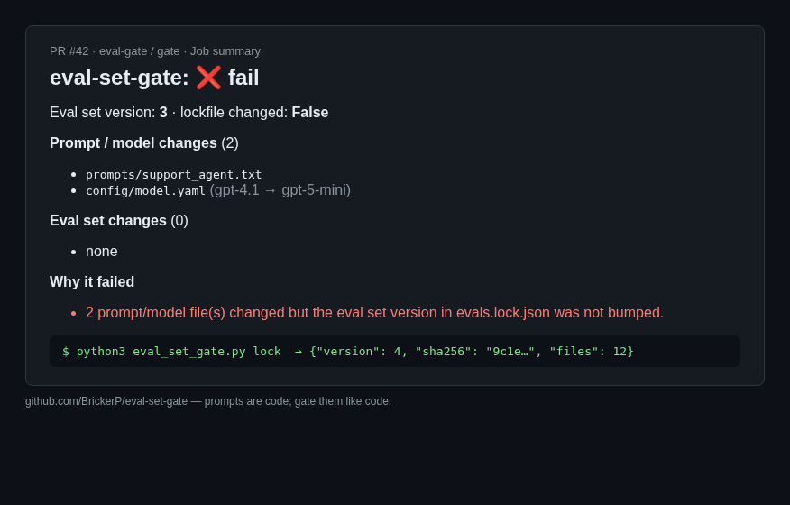

# eval-set-gate

[](https://github.com/BrickerP/eval-set-gate/actions/workflows/ci.yml)

**A GitHub Action that fails a PR when someone changes a prompt or model config without bumping the versioned eval set.**

Prompt edits are code changes. If `prompts/system.txt` or `model.yaml` changes but the eval set that's supposed to cover it doesn't, you ship an untested behavior change. This gate makes that explicit in CI.



## How it works
- `evals.lock.json` stores the eval set **version** and a **sha256** of all eval files.
- On a PR, the action diffs against the base branch:
  - prompt/model files changed **and** lockfile unchanged → ❌ fail
  - eval files changed but lockfile hash stale → ❌ fail
  - otherwise → ✅ pass
- A Markdown summary (changed prompts, changed evals, reasons) is written to the job summary.

Stdlib-only Python, no install step, no network calls, no API keys.

## Quick start
1. Create the lockfile once (and whenever you update evals):
   ```bash
   curl -sO https://raw.githubusercontent.com/BrickerP/eval-set-gate/main/src/eval_set_gate.py
   python3 eval_set_gate.py lock          # writes evals.lock.json, bumps version if evals changed
   git add evals.lock.json && git commit -m "evals: bump"
   ```
2. Add `.github/workflows/eval-gate.yml`:
   ```yaml
   name: eval-gate
   on: pull_request
   jobs:
     gate:
       runs-on: ubuntu-latest
       steps:
         - uses: actions/checkout@v4
           with: { fetch-depth: 0 }
         - uses: BrickerP/eval-set-gate@v1
           with:
             watch: "prompts/**,config/model*.yaml"
             evals: "evals/**"
   ```

## Inputs
| input | default | meaning |
|---|---|---|
| `watch` | `prompts/**,**/*.prompt,**/*.prompt.md,**/model*.{yaml,yml,json},**/llm*.yaml` | prompt / model config globs |
| `evals` | `evals/**` | eval set globs |
| `lockfile` | `evals.lock.json` | version + hash file |
| `base` | `origin/<PR base>` | ref to diff against |

## CLI
```
python3 src/eval_set_gate.py lock                 # regenerate lockfile
python3 src/eval_set_gate.py verify               # exit 1 if lock is stale
python3 src/eval_set_gate.py check --base main    # same check the Action runs
```

## Development
```
python3 -m unittest discover -s tests -v
```

## Author
Built by Yupeng Lu — AI agent & backend engineer. I take agents from demo to production: MCP tools, guardrails, evals, billing, real-time systems. Hire me: https://brickerp.github.io/hire/

MIT License.
